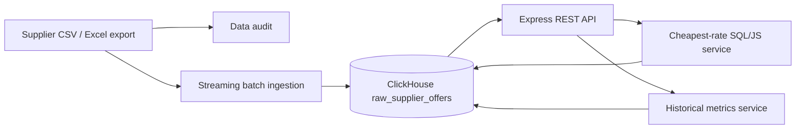

# Dubai Hotel Supplier Intelligence

Node.js 22/Express backend with ClickHouse for deterministic cheapest-supplier selection and explainable historical supplier scoring.

## Architecture



## Dataset findings

The supplied `dubai_100_records_per_hotel_supplier_training (2).csv` was inspected before implementation:

- 100,000 rows
- 1,000 unique hotels
- 5,000 unique Search IDs
- Five suppliers: A, B, C, D, E
- 50,000 RO and 50,000 BB rows
- 50,000 refundable and 50,000 non-refundable rows
- 100 rows for every hotel
- 22,995 missing Net_Rate_AED values
- 77,005 AVAILABLE, 10,435 NO_RATE, and 12,560 NOT_MAPPED rows
- No duplicate rows, invalid negative rates, or invalid currencies detected

## Setup and run instructions

### Prerequisites

- Node.js 22 or newer
- npm (included with Node.js)
- Docker Desktop, or a reachable ClickHouse server

Check the Node.js and npm versions:

```powershell
node --version
npm --version
```

### 1. Install dependencies

Open PowerShell in the project directory and run:

```powershell
npm install
```

### 2. Configure environment variables

Create your local environment file:

```powershell
Copy-Item .env.example .env
```

The default `.env.example` uses `localhost:8123`, database `hotel_intelligence`, and password `admin123`. Update `.env` if you use a different ClickHouse server or credentials.

### 3. Start ClickHouse

If Docker Desktop is installed, start the supplied ClickHouse service:

```powershell
docker compose up -d
```

Wait until Docker reports the container is running, then verify ClickHouse:

```powershell
Invoke-RestMethod "http://localhost:8123/ping"
```

The response should be `Ok.`

For an existing ClickHouse installation, make sure `CLICKHOUSE_HOST`, `CLICKHOUSE_DATABASE`, `CLICKHOUSE_USERNAME`, and `CLICKHOUSE_PASSWORD` in `.env` point to it.

### 4. Initialize the database tables

Run this command from the project directory:

```powershell
curl.exe --data-binary "@sql/01_create_tables.sql" "http://localhost:8123/?multiquery=1"
```

The configured database defaults to `hotel_intelligence`.

### 5. Audit and import the supplier data

Audit the bundled CSV first:

```powershell
npm run audit:csv
```

Import the CSV into ClickHouse:

```powershell
npm run import:csv
```

Set `DATASET_PATH` in `.env` to import another CSV file. Set `CSV_BATCH_SIZE` to change the import batch size.

### 6. Start the application

Build the React frontend and start the API:

```powershell
npm start
```

Open [http://localhost:3000](http://localhost:3000). The health endpoint is available at [http://localhost:3000/health](http://localhost:3000/health).

For frontend development, use two terminals:

```powershell
# Terminal 1: API
npm run dev

# Terminal 2: Vite frontend
npm run dev:frontend
```

The Vite development server normally starts at [http://localhost:5173](http://localhost:5173) and proxies API requests to port 3000.

### Stop the local services

Stop the application with `Ctrl+C`, then stop ClickHouse:

```powershell
docker compose down
```

## CSV import

The supplied file is copied to `data/supplier_offers.csv`.

```bash
npm run audit:csv
npm run import:csv
```

Set `DATASET_PATH` and `CSV_BATCH_SIZE` to import another file or change batch size. CSV parsing is streamed and ClickHouse inserts are batched. Missing monetary values remain `null`; they are never converted to zero. Duplicate keys are logged and ReplacingMergeTree uses ingestion timestamp to retain only the latest version. Invalid rows are rejected and counted.

For Excel input, convert `.xlsx` to CSV while preserving headers and text values:

```text
LibreOffice: open workbook, choose Save As .csv (UTF-8)
```

No Excel conversion dependency is included by default. This avoids silently changing data types.

## API

The React hotel finder is served at `http://localhost:3000/`. Ask for a hotel and choose a meal plan and cancellation policy to rank the lowest available offers across the supplied dataset.

```text
GET /api/v1/hotels/search?mealPlan=RO&cancellationPolicy=Non-Refundable
```

The search returns up to ten hotels ordered by their cheapest eligible supplier rate, comparing the lowest available offer per supplier across all search records. Rates may therefore come from different searches and are not a like-for-like quote for specific travel dates. The ranking uses the available offer data only; hotel amenities, dates, and guest reviews are not part of this dataset. `npm start` builds the React frontend before starting the API. For frontend development, run the API with `npm run dev` and Vite with `npm run dev:frontend`.

```bash
curl "http://localhost:3000/api/v1/hotels/DXB00001/supplier-recommendation?searchId=SRCH0000001&mealPlan=RO&cancellationPolicy=Non-Refundable"
```

Example fields:

```json
{
  "searchId": "SRCH0000001",
  "hotelId": "DXB00001",
  "mealPlan": "RO",
  "cancellationPolicy": "Non-Refundable",
  "currency": "AED",
  "cheapestSupplier": "Supplier D",
  "cheapestRateAED": 544.68,
  "runnerUpSupplier": "Supplier A",
  "runnerUpRateAED": 560.10,
  "savingVsRunnerUpAED": 15.42,
  "savingVsRunnerUpPct": 2.75,
  "supplierOffers": [],
  "reasonCodes": ["LOWEST_ELIGIBLE_RATE"],
  "historicalRecommendation": null,
  "recommendationConfidence": null,
  "latencyMs": 0
}
```

Zod validates the search ID, hotel ID, meal plan, and cancellation policy. SQL uses ClickHouse `query_params`; user input is never concatenated.

## Algorithm

Eligibility requires `Available=Yes`, `Supplier_Status=AVAILABLE`, non-null positive `Net_Rate_AED`, and AED currency. Rankings isolate `Search_ID`, hotel, meal plan, and cancellation policy. `Net_Rate_AED ASC, Supplier ASC` makes ties deterministic. A real equal-price top pair adds `PRICE_TIE`; alphabetical ordering alone does not.

Reason codes also cover missing, unavailable, no-rate, insufficient competition, and no eligible rate.

## Historical recommendation

Separate from the current cheapest result, the score is:

`0.40 * WinRate + 0.35 * PriceAdvantage + 0.25 * AvailabilityCoverage`

Each input is normalized to a 0–100 scale. Confidence is LOW, MEDIUM, or HIGH using configurable sample thresholds. Missing or poor-sample suppliers are not fabricated as successes.

The supplied data has no stay dates, booking conversions, uptime, or fulfillment outcomes. Those limitations are documented and no booking success data is inferred.

## ClickHouse choices

`ReplacingMergeTree(Ingested_At)` supports duplicate and incremental re-ingestion. The partition is monthly by ingestion time and the primary key is optimized for exact offer-group filters and supplier ranking. For 80 suppliers, add LowCardinality where appropriate, widen only if needed, and use a separate supplier dimension table if more metadata is required.

For historical metrics, maintain or add a materialized aggregate table in production. Redis caching is optional; cache exact five-part keys and invalidate on ingestion completion. `p95 < 500 ms` is an initial objective and must be measured under a defined workload; no benchmark is claimed here.

## Tests

```bash
npm test
```

Jest covers normal/price-tie/missing/NO_RATE/NOT_MAPPED/unavailable/one/no eligible selection, validation, meal/cancellation isolation, and insufficient historical samples.

## Limitations

- Docker must be started outside this environment because Docker is unavailable here.
- Live ClickHouse integration could not be run here.
- Historical SQL and API integration should be benchmarked after ClickHouse startup.
- Redis and ML are not trained or enabled.
