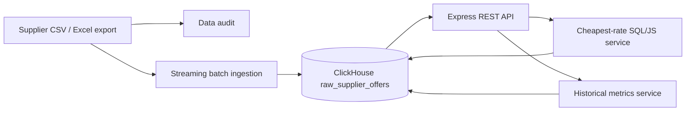

# Dubai Hotel Supplier Intelligence

Node.js 22/Express backend with ClickHouse for deterministic cheapest-supplier selection and explainable historical supplier scoring.

## Architecture



## Dataset findings

The supplied `dubai_100_records_per_hotel_supplier_training (2).csv` was inspected before implementation:

- 100,000 rows
- 1,000 unique hotels
- 5,000 unique Search IDs
- Five suppliers: A, B, C, D, E
- 50,000 RO and 50,000 BB rows
- 50,000 refundable and 50,000 non-refundable rows
- 100 rows for every hotel
- 22,995 missing Net_Rate_AED values
- 77,005 AVAILABLE, 10,435 NO_RATE, and 12,560 NOT_MAPPED rows
- No duplicate rows, invalid negative rates, or invalid currencies detected

## Supplier recommendation requirements

The supplier recommendation must account for both parts of an offer:

- **Meal plan:** Room Only (RO) or Bed & Breakfast (BB)
- **Cancellation policy:** refundable or non-refundable

Together these define four distinct offer groups: RO refundable, RO non-refundable, BB refundable, and BB non-refundable. Rates must only be compared within the same group and the same search context. For a given hotel, the lowest eligible rate can come from a different supplier in each group; for example, one supplier may be strongest for RO while another is strongest for refundable RO. Do not select one supplier as the winner for every offer type at a hotel.

The requested output is a clear signal of which supplier wins for each hotel and offer group, along with the competing offers and enough historical context to identify suppliers that reliably perform well. “Golden supplier” therefore means the best-performing supplier for a particular hotel and offer group, not a single universal supplier. Current cheapest-rate selection and historical supplier performance are separate signals: the current cheapest offer is the best eligible rate for that search, while historical metrics help assess a supplier's past competitiveness and availability.

The comparison should use the exact search context and equivalent offer conditions. At minimum, isolate by search ID, hotel, meal plan, and cancellation policy; include any additional quote-defining search keys (such as stay dates, occupancy, or room conditions) when they are present in the source data. Compare rates in a common currency and exclude unavailable, unmapped, missing, or invalid-price offers from cheapest-rate selection. Resolve equal prices deterministically and report ties rather than implying a unique winner.

The current dataset has about 100,000 rows and five suppliers. The design should anticipate growth to millions of offer records and approximately 80 suppliers, as well as searches with multiple search keys. ClickHouse is the project's analytical store for ingestion and high-volume filtering/ranking. Streamed, batched imports and exact-key queries are already used; production readiness at the larger scale still requires workload-based latency and capacity benchmarks. A persistent aggregate or materialized view can support historical performance summaries as data grows.

Supplier coverage should not be assumed to remain at the current five suppliers: avoid making supplier-specific business logic depend on a fixed supplier list when expanding the integration. Preserve explicit outcomes for missing, unavailable, and no-rate suppliers so the recommendation remains explainable as suppliers are added.

## Setup and run instructions

### Prerequisites

- Node.js 22 or newer
- npm (included with Node.js)
- Docker Desktop, or a reachable ClickHouse server

Check the Node.js and npm versions:

```powershell
node --version
npm --version
```

### 1. Install dependencies

Open PowerShell in the project directory and run:

```powershell
npm install
```

### 2. Configure environment variables

Create your local environment file:

```powershell
Copy-Item .env.example .env
```

The default `.env.example` uses `localhost:8123`, database `hotel_intelligence`, and password `admin123`. Update `.env` if you use a different ClickHouse server or credentials.

### 3. Start ClickHouse

If Docker Desktop is installed, start the supplied ClickHouse service:

```powershell
docker compose up -d
```

Wait until Docker reports the container is running, then verify ClickHouse:

```powershell
Invoke-RestMethod "http://localhost:8123/ping"
```

The response should be `Ok.`

For an existing ClickHouse installation, make sure `CLICKHOUSE_HOST`, `CLICKHOUSE_DATABASE`, `CLICKHOUSE_USERNAME`, and `CLICKHOUSE_PASSWORD` in `.env` point to it.

### 4. Initialize the database tables

Run this command from the project directory:

```powershell
curl.exe --data-binary "@sql/01_create_tables.sql" "http://localhost:8123/?multiquery=1"
curl.exe --data-binary "@sql/04_best_offers_view.sql" "http://localhost:8123/?multiquery=1"
```

The configured database defaults to `hotel_intelligence`. The second script creates the query-time `best_offers` view over the raw records. It includes a row for each exact search/hotel/meal/policy group, including groups with no eligible offers.

### 5. Audit and import the supplier data

Audit the bundled CSV first:

```powershell
npm run audit:csv
```

Import the CSV into ClickHouse:

```powershell
npm run import:csv
```

Set `DATASET_PATH` in `.env` to import another CSV file. Set `CSV_BATCH_SIZE` to change the import batch size.

### 6. Start the application

Build the React frontend and start the API:

```powershell
npm start
```

Open [http://localhost:3000](http://localhost:3000). The health endpoint is available at [http://localhost:3000/health](http://localhost:3000/health).

For frontend development, use two terminals:

```powershell
# Terminal 1: API
npm run dev

# Terminal 2: Vite frontend
npm run dev:frontend
```

The Vite development server normally starts at [http://localhost:5173](http://localhost:5173) and proxies API requests to port 3000.

### Stop the local services

Stop the application with `Ctrl+C`, then stop ClickHouse:

```powershell
docker compose down
```

## CSV import

The supplied file is copied to `data/supplier_offers.csv`.

```bash
npm run audit:csv
npm run import:csv
```

Set `DATASET_PATH` and `CSV_BATCH_SIZE` to import another file or change batch size. CSV parsing is streamed and ClickHouse inserts are batched. Missing monetary values remain `null`; they are never converted to zero. Duplicate keys are logged and ReplacingMergeTree uses ingestion timestamp to retain only the latest version. Invalid rows are rejected and counted.

Run a reproducible local demonstration using the bundled sample. It prints a valid comparison from the CSV, a sample group where Supplier D has `NO_RATE` or `NOT_MAPPED`, and a deterministic equal-price tie:

```powershell
npm run demo:rate
```

For Excel input, convert `.xlsx` to CSV while preserving headers and text values:

```text
LibreOffice: open workbook, choose Save As .csv (UTF-8)
```

No Excel conversion dependency is included by default. This avoids silently changing data types.

## API

The React hotel finder is served at `http://localhost:3000/`. Ask for a hotel and choose a meal plan and cancellation policy to rank the lowest available offers across the supplied dataset.

```text
GET /api/v1/hotels/search?mealPlan=RO&cancellationPolicy=Non-Refundable
```

The search returns up to ten hotels ordered by their cheapest eligible supplier rate, comparing the lowest available offer per supplier across all search records. Rates may therefore come from different searches and are not a like-for-like quote for specific travel dates. The ranking uses the available offer data only; hotel amenities, dates, and guest reviews are not part of this dataset. `npm start` builds the React frontend before starting the API. For frontend development, run the API with `npm run dev` and Vite with `npm run dev:frontend`.

```bash
curl "http://localhost:3000/api/v1/hotels/DXB00001/supplier-recommendation?searchId=SRCH0000001&mealPlan=RO&cancellationPolicy=Non-Refundable"
```

Example fields:

```json
{
  "searchId": "SRCH0000001",
  "hotelId": "DXB00001",
  "mealPlan": "RO",
  "cancellationPolicy": "Non-Refundable",
  "currency": "AED",
  "cheapestSupplier": "Supplier D",
  "cheapestRateAED": 544.68,
  "runnerUpSupplier": "Supplier A",
  "runnerUpRateAED": 560.10,
  "savingVsRunnerUpAED": 15.42,
  "savingVsRunnerUpPct": 2.75,
  "supplierOffers": [],
  "reasonCodes": ["LOWEST_ELIGIBLE_RATE"],
  "historicalRecommendation": null,
  "historicalRecommendationStatus": "INSUFFICIENT_HISTORY",
  "recommendationConfidence": null,
  "cache": {"status": "miss", "ageMs": 0},
  "latencyMs": 0
}
```

Zod validates the search ID, hotel ID, meal plan, and cancellation policy. SQL uses ClickHouse `query_params`; user input is never concatenated.

Responses report `historicalRecommendationStatus` (`AVAILABLE`, `INSUFFICIENT_HISTORY`, or `UNAVAILABLE`) and cache status. The API caches exact recommendation keys in process memory for 30 seconds by default. If ClickHouse fails after a previously successful response expires, the API can serve that response for up to five additional minutes, explicitly marked `cache.status: "stale-fallback"` with its age. If there is no usable cached result, the endpoint returns HTTP 503 rather than inventing a recommendation. This cache is per application instance; multi-instance deployments need a shared cache and ingestion-driven invalidation.

The `best_offers` view exposes the current winner, runner-up, savings, tie count, and eligible supplier count per exact search group. It deduplicates to the latest ingested version and applies the same eligibility and deterministic ordering rules as the API. Example:

```sql
SELECT *
FROM hotel_intelligence.best_offers
WHERE Search_ID = 'SRCH0000001'
  AND Hotel_ID = 'DXB00001'
  AND Meal_Plan = 'RO'
  AND Cancellation_Policy = 'Non-Refundable';
```

## Algorithm

Eligibility requires `Available=Yes`, `Supplier_Status=AVAILABLE`, non-null positive `Net_Rate_AED`, and AED currency. Rankings isolate `Search_ID`, hotel, meal plan, and cancellation policy. `Net_Rate_AED ASC, Supplier ASC` makes ties deterministic. A real equal-price top pair adds `PRICE_TIE`; alphabetical ordering alone does not.

Reason codes also cover missing, unavailable, no-rate, insufficient competition, and no eligible rate.

## Historical recommendation

Separate from the current cheapest result, the score is:

`0.40 * WinRate + 0.35 * PriceAdvantage + 0.25 * AvailabilityCoverage`

Each input is normalized to a 0–100 scale. Confidence is LOW, MEDIUM, or HIGH using configurable sample thresholds. Missing or poor-sample suppliers are not fabricated as successes.

The supplied data has no stay dates, booking conversions, uptime, or fulfillment outcomes. Those limitations are documented and no booking success data is inferred.

### Open-source model roadmap

The current production baseline remains deterministic, explainable SQL/rules. Do not train a booking-conversion or fulfillment model from the supplied data: those labels are absent. Once reliable labels exist, evaluate LightGBM or CatBoost as open-source ranking candidates. Candidate features include normalized price and price rank within the exact offer group, supplier availability and mapping status, meal plan, cancellation class, hotel, and (once collected) lead time, stay duration, and cancellation deadline. Only use booking conversion or successful fulfillment as labels after those outcomes are collected and definitions are agreed.

Validate with time-based, search-grouped train/validation/test splits so offers from one search cannot leak across splits. Compare against the deterministic cheapest-rate baseline using ranking metrics and business outcomes; calibrate confidence and retain an explainable rule-based fallback. Exclude post-booking and future-derived fields from prediction features, monitor feature/label drift and supplier coverage, and version datasets/models with a documented retraining and rollback process.

Future HB/FB support requires adding those meal-plan values consistently to ingestion validation, API validation, storage, and queries; current filters must continue to isolate meal plans. Dated cancellation terms require explicit deadline/time-zone and fee fields from suppliers, including a versioned normalization policy; the current refundable/non-refundable flag and synthetic fee are not substitutes for actual free-cancellation deadlines.

## ClickHouse choices

`ReplacingMergeTree(Ingested_At)` supports duplicate and incremental re-ingestion. The partition is monthly by ingestion time and the primary key is optimized for exact offer-group filters and supplier ranking. For 80 suppliers, add LowCardinality where appropriate, widen only if needed, and use a separate supplier dimension table if more metadata is required.

The supplier list is configurable through `SUPPLIER_NAMES` and is also expanded from suppliers observed in offer data, so new supplier rows are not dropped from ranking output. Configure the full supplier registry to report expected suppliers that are missing from a result.

The `best_offers` object is a normal view and recomputes from the raw table; it is convenient for correctness and auditability, not a pre-aggregated acceleration layer. For larger production workloads, benchmark first, then consider a refreshable/materialized aggregate that preserves latest-version semantics and exact search-group keys. The current bounded in-memory cache is exact-keyed, and its TTL, stale window, and entry limit are configurable in `.env`.

Run the API before collecting an endpoint latency sample:

```powershell
npm run benchmark:api
```

The benchmark makes sequential requests for one exact key, reports first-request latency and warm-path p50/p95, and can enforce `BENCHMARK_TARGET_P95_MS`. A local 10-request smoke run against ClickHouse measured one cache miss and nine hits: first-request client latency 837.20 ms, warm client p50 7.55 ms, warm client p95 11.41 ms, and API-reported p95 715.09 ms across all requests. The 500 ms warm-path p95 is an initial objective; this single-instance smoke run is not a cold-query capacity or multi-user load test, and the threshold was not explicitly enabled for that run.

## Tests

```bash
npm test
```

Jest covers normal/price-tie/missing/NO_RATE/NOT_MAPPED/unavailable/one/no eligible selection, validation, meal/cancellation isolation, and insufficient historical samples.
`npm run demo:rate` demonstrates sample-data comparison, Supplier D `NO_RATE`/`NOT_MAPPED`, and a deterministic tie without requiring ClickHouse. `npm run benchmark:api` measures the running API's sequential warm-cache path.

## Limitations

- Docker must be started outside this environment because Docker is unavailable here.
- The `best_offers` view was created and queried against the reachable local ClickHouse instance. The API has a local smoke benchmark, but historical SQL and the end-to-end API path still need representative workload and concurrency benchmarking.
- The current cache is process-local; use shared cache/invalidation for multiple API replicas.
- Redis is not deployed, and no ML model is trained.
